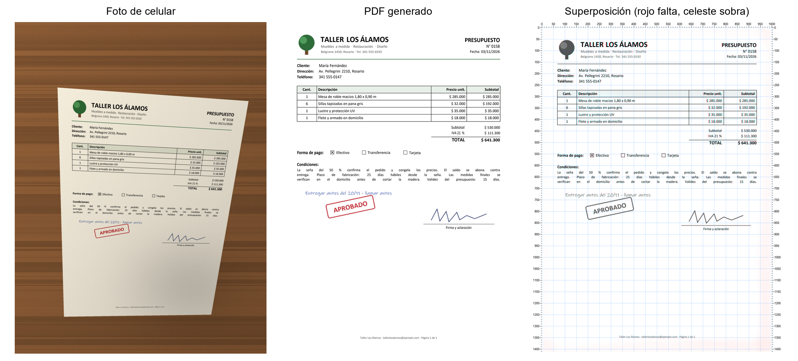

# foto-a-pdf

Skill para [Claude Code](https://claude.com/claude-code) que convierte la **foto de un documento en un PDF con el diseño a medida**. Sirve para facturas, presupuestos, formularios, cartas, recibos y apuntes.

Claude analiza la foto de arriba a abajo, renglón por renglón. Después arma un PDF donde cada texto, tabla, línea, casilla, logo y firma queda en el mismo lugar y del mismo tamaño que en la foto. El texto es **texto real**: se puede seleccionar, copiar y buscar. No es la foto pegada dentro de un PDF.



*Ejemplo incluido en [`ejemplos/presupuesto`](ejemplos/presupuesto): de una foto torcida, con sombra y sobre una mesa, a un [PDF A4](ejemplos/presupuesto/resultado.pdf). En la superposición coincide el 99 % de la tinta.*

## Instalación

### Requisitos

- Claude Code.
- Python 3.10 o más nuevo.
- Las librerías de Python. Después de instalar la skill, corré esto una vez:

  ```bash
  pip install pillow numpy reportlab pypdfium2
  ```

  Para fotos `.heic` de iPhone sumá `pillow-heif`. Si no las instalaste, Claude te las pide la primera vez.

### Opción 1: como plugin (recomendada)

Dentro de Claude Code, escribí:

```
/plugin marketplace add Tpskevin13/foto-a-pdf
/plugin install foto-a-pdf@foto-a-pdf
```

También se puede hacer desde la terminal:

```bash
claude plugin marketplace add Tpskevin13/foto-a-pdf
```

```bash
claude plugin install foto-a-pdf@foto-a-pdf
```

Reiniciá Claude Code. Para actualizar más adelante, usá `/plugin marketplace update foto-a-pdf`.

### Opción 2: copiar la skill a mano

Copiá la carpeta `skills/foto-a-pdf` a tu carpeta de skills personales:

- Windows: `%USERPROFILE%\.claude\skills\foto-a-pdf`
- macOS / Linux: `~/.claude/skills/foto-a-pdf`

```bash
git clone https://github.com/Tpskevin13/foto-a-pdf.git
```

```bash
cp -r foto-a-pdf/skills/foto-a-pdf ~/.claude/skills/
```

En Windows, en PowerShell:

```powershell
Copy-Item -Recurse foto-a-pdf\skills\foto-a-pdf "$env:USERPROFILE\.claude\skills\"
```

Para que la use un solo proyecto, copiala a `.claude/skills/` dentro de ese proyecto.

## Uso

Pasale la foto a Claude y pedile el PDF:

> Pasá a PDF la foto `C:\Users\yo\Descargas\factura.jpg`, es una hoja A4

> Digitalizá este formulario respetando el formato

También podés llamar a la skill directamente. Si la instalaste como plugin, el comando es `/foto-a-pdf:foto-a-pdf ruta/de/la/foto.jpg`. Si la copiaste a mano, es `/foto-a-pdf ruta/de/la/foto.jpg`.

Si pegaste la imagen en el chat, Claude busca las últimas imágenes de Descargas, Escritorio e Imágenes y te confirma cuál es. Lo más seguro es darle la ruta del archivo.

El PDF queda al lado de la foto, con el mismo nombre. Si ya hay uno con ese nombre, no lo pisa. Al terminar, Claude te dice qué tan bien coincide con la foto y qué partes no pudo leer: las marca con `[?]` o `[ilegible]`.

## Cómo funciona

1. **Enderezar** (`preparar.py`). Detecta la hoja en la foto, corrige la perspectiva y estima el tamaño real del papel (A4, carta, oficio…). También empareja la luz.
2. **Cortar en franjas**. Divide la hoja en franjas horizontales ampliadas, con reglas. Así Claude puede leer cada renglón de cerca, de arriba a abajo.
3. **Describir**. Claude escribe un `layout.json` con cada elemento y su posición: textos, líneas, recuadros, casillas, tablas e imágenes. Los logos, sellos y firmas se recortan de la foto. Las posiciones se miden en "u", donde el ancho de la página es 1000 u.
4. **Encajar** (`encajar.py`). Ajusta cada caja a la tinta real de la foto: la línea base, el alto de las letras, dónde empieza cada palabra y dónde están los bordes de tablas y líneas.
5. **Dibujar** (`construir.py`). Arma el PDF con ReportLab y fuentes TrueType. El tamaño de letra sale del alto medido de ese texto en esa fuente.
6. **Comparar** (`comparar.py`). Renderiza el PDF y lo superpone con la foto: en rojo lo que falta, en celeste lo que sobra. Da la cobertura y la precisión por franja. Claude corrige y repite.

Los pasos están detallados en [`skills/foto-a-pdf/SKILL.md`](skills/foto-a-pdf/SKILL.md).

## Probarlo sin una foto propia

```bash
python ejemplos/generar_prueba.py prueba
```

Crea un presupuesto ficticio (`prueba/original.pdf`) y una foto simulada de celular (`prueba/foto_presupuesto.jpg`). La foto tiene perspectiva, luz despareja, ruido y desenfoque. Después pedile a Claude que pase esa foto a PDF y compará el resultado con el original. El generador usa fuentes de Windows.

## Limitaciones

- El texto es una **transcripción** hecha por Claude. Revisá siempre números, nombres y montos.
- La tipografía es la más parecida que haya en tu equipo (Arial, Times, Courier, Calibri…), no la original.
- Una foto muy borrosa, muy oblicua, con poca luz o con la hoja curvada (un libro abierto) da peores resultados.
- Cada foto es una página. Para varias páginas, se prepara cada foto y se juntan en un solo PDF.

## Licencia

[MIT](LICENSE)
